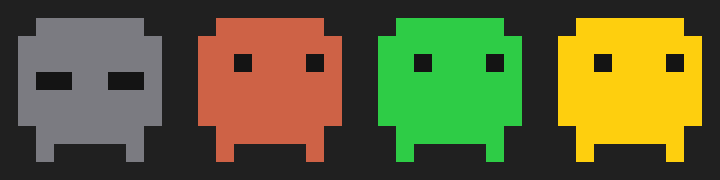

# Clawd Bar

A tiny macOS menu bar app that tells you, at a glance, whether your
[Claude Code](https://claude.com/claude-code) sessions are working, waiting
for you, or done, so you can stop switching back to the terminal to check.



| Icon | Meaning |
|------|---------|
| Gray, eyes closed | No Claude Code sessions are running |
| Orange, pulsing | At least one session is working |
| Yellow, with project name | A session needs you: a permission prompt, a question, or an input dialog |
| Green | Every session has finished its turn |

The most urgent state wins. When a session is waiting, its project name
appears next to the icon (`my-app +1` if more than one is waiting).
Click the icon for a per-session list with what each one is doing and for how
long. Clicking a row brings Warp to the front.

## Requirements

- macOS 14 Sonoma or later
- Xcode 15+ command line tools (Swift 5.10+) to build
- Claude Code with hooks support

## Install

```sh
git clone https://github.com/<you>/clawd-bar.git
cd clawd-bar
make install          # builds, copies to /Applications and launches
```

Then click the icon and choose **Install Claude Code Hooks…**. Sessions you
start after that show up in the menu bar. Sessions that were already running
appear once they fire their next event.

Optional toggles in the menu:

- **Notify When Waiting or Done** sends a macOS notification on those transitions.
- **Play Sound** plays a short chime on the same transitions.
- **Launch at Login** registers the app as a login item.

## How it works

```
Claude Code ──hook event (JSON on stdin)──▶ clawd-hook ──writes──▶ ~/.claude/clawd-bar/sessions/<id>.json
                                                                              │
                                                     Clawd Bar ◀──watches─────┘
```

- **`clawd-hook`** is a small command-line tool bundled inside the app. Claude
  Code runs it for a dozen [hook events](https://code.claude.com/docs/en/hooks)
  such as `UserPromptSubmit`, `PermissionRequest`, `Notification`, `Stop`, and
  `SessionEnd`. It maps each event to a state and atomically writes one JSON
  file per session. It never prints to stdout and always exits 0, so it can
  never block or alter a Claude session.
- **Clawd Bar** watches that directory, aggregates the files, and renders the
  icon and menu. Every 15 seconds it also drops sessions whose Claude process
  has exited without sending `SessionEnd`.
- **Installing hooks** adds entries to `~/.claude/settings.json` that call
  `~/.claude/clawd-bar/bin/clawd-hook`, a symlink into the app bundle. Existing
  hooks and settings are preserved, and the previous file is saved as
  `settings.json.clawd-backup`.

## Known limitations

- **Warp tab focus.** Warp has no scripting API for selecting a tab, so clicking
  a row activates Warp but cannot jump to the exact tab.
- **Yellow lingers after approval.** Claude Code does not emit an event when you
  approve a permission prompt. The icon turns orange again when that tool call
  finishes.
- **Headless runs count.** `claude -p` invocations from scripts also appear,
  since hooks cannot tell interactive and headless sessions apart.

## Development

```sh
make test             # unit tests for the core logic
make app              # build "build/Clawd Bar.app"
make run              # build and open it
```

The code is split into three targets:

- `ClawdCore`: the platform-independent state machine, storage, and aggregation. Fully unit tested.
- `clawd-hook`: the hook executable.
- `ClawdBar`: the AppKit menu bar app.

## Uninstall

Choose **Remove Claude Code Hooks** from the menu, then run `make uninstall`
and delete `~/.claude/clawd-bar`.

## License

MIT. Clawd Bar is an independent project and is not affiliated with Anthropic.
