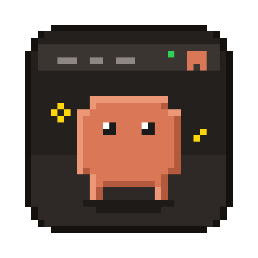

<p align="center"></p>

# Clawd Bar

A tiny macOS menu bar app that tells you, at a glance, whether your
[Claude Code](https://claude.com/claude-code) sessions are working, waiting
for you, or done, so you can stop switching back to the terminal to check.


| Icon | Meaning |
|------|---------|
| Gray, eyes closed | No Claude Code sessions are running |
| Orange | At least one session is working |
| Yellow, with project name | A session needs you: a permission prompt, a question, or an input dialog |
| Green | Every session has finished its turn |

The most urgent state sets the color. Whenever at least one session is
working, Clawd hops in place, even while another session is waiting for you:

 When a session is waiting, its project name
appears next to the icon (`my-app +1` if more than one is waiting).
Click the icon for a per-session list with what each one is doing and for how
long. Each row is labeled with the session's name: the one you set with
`/rename`, or else the title Claude Code generated for the conversation. Clicking a row brings Warp to the front.

## Requirements

- macOS 14 Sonoma or later
- Xcode 15.3 or later (Swift 5.10+) to build
- Claude Code with hooks support

## Install

```sh
git clone https://github.com/soneralp/clawd-bar.git
cd clawd-bar
make install          # builds, copies to /Applications and launches
```

Then click the icon and choose **Install Claude Code Hooks…**. Claude Code
reads hooks when a session starts, so restart any sessions that are already
running.

**Alarms.** Each row has a bell. Click it to arm an alarm for that session:
Clawd Bar plays a short chime every time the session finishes a turn or starts
waiting for you. Click it again to turn the alarm off. Alarms are forgotten
when the session ends. The chime follows your system output volume.

**Launch at Login** in the menu registers the app as a login item.

## How it works

```
Claude Code ──hook event (JSON on stdin)──▶ clawd-hook ──writes──▶ ~/.claude/clawd-bar/sessions/<id>.json
                                                                              │
                                                     Clawd Bar ◀──watches─────┘
```

- **`clawd-hook`** is a small command-line tool bundled inside the app. Claude
  Code runs it for a dozen [hook events](https://code.claude.com/docs/en/hooks)
  such as `UserPromptSubmit`, `PermissionRequest`, `Notification`, `Stop`, and
  `SessionEnd`. It maps each event to a state and atomically writes one JSON
  file per session, under a per-session file lock. To pick up the session's
  name it reads only the last 64 KB of the transcript. It never prints to stdout
  and always exits 0, so it cannot change what Claude does. It does run
  synchronously, which adds a few milliseconds per tool call.
- **Clawd Bar** watches that directory, aggregates the files, and renders the
  icon and menu. Every 15 seconds it also drops sessions whose Claude process
  has exited without sending `SessionEnd`.
- **Installing hooks** adds entries to `~/.claude/settings.json` that call
  `~/.claude/clawd-bar/bin/clawd-hook`, a symlink into the app bundle. Existing
  hooks and settings are preserved, and a symlinked `settings.json` stays a
  symlink. Before the first change, the original file is saved as
  `settings.json.clawd-backup`. If the app is deleted without removing its
  hooks, the hook command quietly does nothing.

## Known limitations

- **Warp tab focus.** Warp has no scripting API for selecting a tab, so clicking
  a row activates Warp but cannot jump to the exact tab.
- **Yellow lingers after approval.** Claude Code does not emit an event when you
  approve a permission prompt. The icon turns orange again when that tool call
  finishes.
- **Interrupting with Esc.** Claude Code sends no hook event when you cancel a
  turn. Clawd Bar notices the interruption in the session transcript and marks
  the session done, which can take up to about 15 seconds.
- **Headless runs count.** `claude -p` invocations from scripts also appear,
  since hooks cannot tell interactive and headless sessions apart.

## Development

```sh
make test             # unit tests for the core logic
make app              # build "build/Clawd Bar.app"
make run              # build and open it
```

The code is split into three targets:

- `ClawdCore`: the platform-independent state machine, storage, and aggregation. Fully unit tested.
- `clawd-hook`: the hook executable.
- `ClawdBar`: the AppKit menu bar app.

## Uninstall

Choose **Remove Claude Code Hooks** from the menu, quit the app, then run
`make uninstall` and delete `~/.claude/clawd-bar`. Running sessions keep
their old hook configuration until they restart.

## Support

Clawd Bar is a personal side project, shared as is. There is no guarantee of
support, fixes, or updates. Issues and pull requests are welcome, but may not
get a response.

## License

MIT. Clawd Bar is an independent project and is not affiliated with Anthropic.
